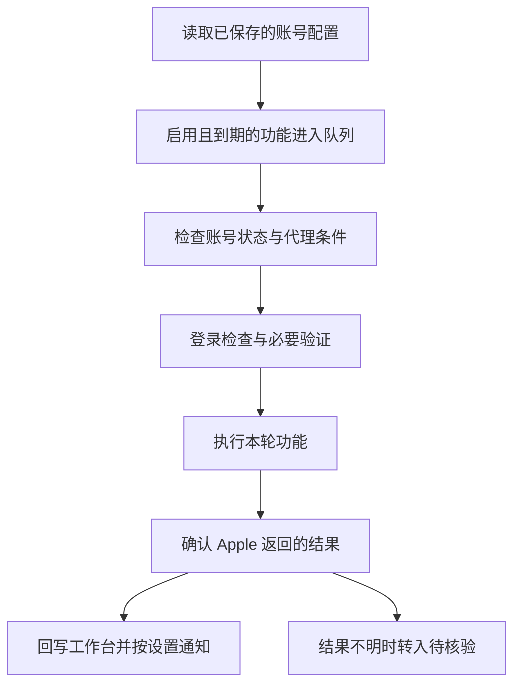

# 自动化功能介绍、运行逻辑与排错指南

本指南面向使用工作台管理 Apple 账号的普通用户，介绍当前版本的自动化功能、执行过程和异常处理。界面中的“自动解除双重认证”需要满足邮件与 Apple 恢复条件，不代表任何账号都能解除；资料恢复、设备移除和改密会实际修改 Apple 账号。

首次配置可配合[配置指南](configuration.md)阅读。需要检查服务器、容器或服务认证时，请管理员参考[运维指南](operations.md)。

## 目录

- [一、快速入门与运行规则](#一快速入门与运行规则)
- [二、五项周期任务](#二五项周期任务)
- [三、邮件恢复与配套功能](#三邮件恢复与配套功能)
- [四、按现象和报错排查](#四按现象和报错排查)
- [五、待核验与主站回写失败](#五待核验与主站回写失败)
- [六、联系管理员时提供什么](#六联系管理员时提供什么)
- [七、失败截图与诊断文件在哪](#七失败截图与诊断文件在哪)

## 一、快速入门与运行规则

### 1. 从哪里操作

| 页面或区域 | 用途 |
| --- | --- |
| Apple账号 | 新建、编辑账号，保存密码、密保问题、恢复邮箱和目标资料；设置功能开关与周期 |
| 自动化任务 | 查看账号任务状态，启用或停用任务，使用“运行到期项” |
| 执行记录 | 查看执行结果和错误提示，区分账号操作失败与通知失败 |
| 消息推送 | 设置当前用户的 Telegram Bot Token、Chat ID 和结果推送范围 |
| 账号编辑中的独立自动化周期 | 查看各项开关、最近结果和下次计划；独立调度启用后可查看时间线和单项操作 |
| 邮件恢复（管理员） | 发起受控“邮件改密”或“安全回退”，查看恢复进度和历史 |

建议先在“Apple账号”核对资料并保存，再按需要开启单项功能和账号总开关。改了输入框但没有点击“保存账号”，不会更新已保存的配置；“测试连通性”也不会代替保存。

### 2. 开关与周期如何生效

- **账号总开关**：决定账号是否参加自动调度。账号停用或被恢复流程冻结后，即使单项开关仍开着，也不会继续自动运行。
- **单项开关**：决定该功能是否执行。设置周期、加入共用周期，都不会自动打开单项开关。
- **网站默认周期**：由管理员设置，账号选择跟随全局时使用。
- **单项自定义周期**：只影响当前账号的这一项；编辑周期数值后会改为单项自定义。
- **账号共用周期**：开启后，只有勾选加入的功能使用这一周期，其他功能保留原周期。关闭共用周期会恢复各项原有设置，并保留成员和数值。

独立周期支持 **1–43200 整数分钟（最长 30 天）**。切换分钟、小时或天只换算显示，不会自行改变时长。

| 功能 | 独立调度的初始默认周期 |
| --- | --- |
| 检测账号密码正确性 | 30 分钟 |
| 自动解除双重认证 | 30 分钟 |
| 自动恢复资料 | 360 分钟（6 小时） |
| 自动移除设备 | 30 分钟 |
| 自动更新密码 | 1440 分钟（1 天） |

上表适用于启用独立调度、且管理员尚未调整网站默认值的情况。请以账号编辑页显示的“生效周期”为准。

如果界面提示“独立调度尚未切换；当前仍按旧检查间隔执行”，说明站点仍使用统一周期。此时按账号的“旧调度兼容间隔（分钟）”运行，不应据单项周期判断是否到期；站点切换由管理员处理。完整规则见[独立周期说明](../automation-server/INDEPENDENT_SCHEDULES.md)。

### 3. 一轮任务怎么运行



这是普通周期任务的主流程。邮件安全回退也可能由邮箱中的有效恢复邮件先触发；仅恢复密码回写时不会访问 Apple。

独立调度约每 30 秒同步配置，执行前重新读取账号状态，修改步骤还会检查执行条件。同一账号的任务串行处理，不会因为连续点击而获得更多执行槽位。

一轮只合并已经到期的功能，通常先检查，再处理资料、设备，最后改密；启用复合工作流的账号可复用一次浏览器登录，默认未启用此模式。未到期功能保留原计划。邮件恢复或安全回退已经改密成功时，会重置独立调度中的改密周期，避免同轮再改一次。

普通下一次执行时间从本次结束后起算，还可能有少量调度抖动；技术故障重试和只读核验使用各自的时间。默认部署只有一个浏览器执行槽位，多账号需要排队，因此“下次计划”并不保证浏览器在该时刻开始。排队时间和浏览器执行时间分开计算。

### 4. 几个按钮的区别

| 按钮 | 会做什么 | 使用前确认 |
| --- | --- | --- |
| 运行到期项 | 独立调度下只提交已启用且已到期的功能，不会提前运行未到期项 | 已保存配置、账号已启用；“当前没有已到期功能”通常无需处理 |
| 单独运行此项 | 独立调度下让选中的已启用功能立即进入队列，可以提前于原计划 | 资料、设备和密码可能因此立即被修改 |
| 先只读核验 | 核对待确认操作的结果，不再提交同一项修改 | 账号及功能需满足核验条件；停用或冻结时先联系管理员判断 |
| 人工确认后重新提交 | 确认提示后重新发起该项操作 | 已人工核对 Apple 当前状态，且确实仍需执行；不能用来代替核验 |

这些单项操作及时间线依赖独立调度状态。旧统一周期下，“运行到期项”走兼容任务入口，不能把它当作独立调度的单项到期筛选；涉及修改时先核对账号所有已启用功能。账号正在执行时应等待结束。

## 二、五项周期任务

### 1. 检测账号密码正确性

**用途与开启条件**：用工作台保存的账号和密码尝试登录，判断是否正常。需要账号总开关与“检测账号密码正确性”开启，账号、密码填写完整；出现密保验证时还需要匹配的问题与答案。

**界面操作**：进入“Apple账号”编辑，核对账号密码及密保资料，开启该功能、设置周期并保存。

**运行步骤**：到期后读取最新凭据和网络设置 → 打开 Apple 登录页面 → 处理验证码或密保 → 判断正常、密码错误、双重认证、锁定或其他挑战 → 回传结果。其他修改功能也需要登录，因此关闭本项不等于其他任务不会校验密码。

**成功表现**：记录显示“账号密码正确性检测成功：账号登录状态正常”，并更新下次计划。它说明本次登录正常，不代表资料恢复或设备清理也成功。

**失败处理**：`password_invalid` 先核对已保存密码；`identity_verification_failed` 还可能涉及限流，不能只据此认定密码错误；密保问题按第四部分核对。已启用“邮件修改密码”且邮箱条件齐全时，特定登录异常可进入邮件恢复；未配置时不会凭空找回密码。

### 2. 自动解除双重认证

**用途与开启条件**：检测双重认证，并在有可用 Apple 官方安全设置恢复邮件时尝试恢复原安全设置。需开启本项、允许“邮件解除双重认证”，并配置能接收对应邮件的恢复邮箱。Apple 还必须允许该账号使用邮件中的恢复链接。

**界面操作**：编辑账号，在“允许使用的恢复方式”中勾选“邮件解除双重认证”，填写恢复邮箱与 IMAPS 信息、测试并保存，再开启本项。

**运行步骤**：本项到期后查找近期、未处理的有效安全恢复邮件；也可在登录检测到双重认证后进入回退流程 → 先冻结账号 → 校验邮件并打开官方链接 → 按页面恢复安全设置并设置新密码 → 确认结果、回写密码并完成恢复。已处理过的一次性邮件不会在以后周期反复使用。

**成功表现**：未发现双重认证时，记录为“双重认证检测成功：未发现需要解除的双重认证”，表示检测通过；真正完成回退时会有解除成功记录和更新后的密码。恢复成功后的账号开关变化见第三部分。

**失败处理**：没有有效邮件、链接过期、Apple 不提供恢复资格时无法自动解除；恢复未完成会保留冻结状态。`two_factor`、`recovery_email_timeout`、`security_rollback_link_expired` 按第四部分处理，不要反复开启账号或复用旧链接。

### 3. 自动恢复资料

**用途与开启条件**：对照已保存的目标资料检查姓名、出生日期、国家/地区和语言，发现差异后尝试改回。需开启本项、账号可正常登录，并填写完整的“个人资料保护基线”。

**界面操作**：在账号编辑页填写姓氏、名字、可选中间名、国家/地区和语言；出生日期使用上方“出生日期”字段。国家/地区和语言按 Apple 的显示名称填写，保存后开启功能。

**运行步骤**：登录 → 读取四项资料 → 分别比较目标值 → 对有差异且能够处理的字段保存目标值 → 确认保存结果 → 回传逐字段说明和最近观测值。已有相同资料时只记录未变化。

**成功表现**：逐字段显示“未发生变化”或“已还原并验证”。请看四项各自结果；某一项恢复成功不代表全部成功，“最近观测值”也应结合检测时间和逐字段说明阅读。

**失败处理**：“保护基线未填写”先补齐目标值；`detect_failed` 表示读取或基线不完整，`restore_failed` 表示还原失败；`manual_required` 表示需要人工处理，例如国家/地区变更涉及额外要求。`uncertain` 表示保存结果不明，先只读核验。若用户本来就想改资料，应先调整保护目标或关闭本项，否则后续可能被自动改回。

### 4. 自动移除设备

**用途与开启条件**：移除该 Apple 账号设备页中的全部设备。需账号可登录并开启本项；当前功能没有保留指定设备的选项。

**界面操作**：在账号编辑页开启“自动移除设备”、设置周期并保存。开启前确认列表中的所有设备都允许被移除。

**运行步骤**：登录 → 打开设备页并等列表稳定 → 打开设备详情 → 点击“从账户中移除”并确认 → 检查列表数量减少 → 继续下一台，直到列表为空。单次有 100 台安全上限。

**成功表现**：“自动移除设备成功：已从账户移除 N 台设备”；原本为空时显示“自动移除设备成功：账号当前没有可移除设备”，同样按成功处理。

**失败处理**：打不开设备详情或找不到按钮时，先核对登录状态，再联系管理员检查页面适配；`device_cleanup_limit` 表示达到单次上限，可能已经处理了部分设备。`device_removal_unconfirmed` 表示移除可能已提交，先核验实际列表，不要直接重复移除。

### 5. 自动更新密码

**用途与开启条件**：按周期生成新密码并更新工作台。需开启本项、账号可登录并完成页面验证；有上一轮未解决的密码暂存时，新改密可能被阻止。

**界面操作**：在账号编辑页开启“自动更新密码”、设置周期并保存。后续需要密码时以完成回写后的工作台为准。

**运行步骤**：完成必要的登录检查，并在提交前保留候选密码（独立调度） → 打开改密表单 → 提交旧密码及新密码 → 等 Apple 明确确认 → 回写工作台 → 再读工作台确认一致 → 删除该次暂存并安排下次周期。执行前关闭或调整计划，可能取消尚未提交的改密步骤。

**成功表现**：“自动更新密码成功：新密码已同步到账号资产页面”，且本项结果成功。出现回写错误时，不能仅凭前面一条成功描述判断整个流程已结束，应同时查看最终状态。

**失败处理**：`password_reused`、`password_policy_rejected` 是 Apple 拒绝候选密码；`password_form_missing` 是未找到可用表单等表单问题。提交后的超时或结果不明按第五部分处理；Apple 已确认但工作台未保存时，应恢复回写，不应再改一次密码。旧统一周期不具备全部独立调度恢复能力，遇到中断请管理员核对。

## 三、邮件恢复与配套功能

### 1. 自动邮件密码恢复

**用途与开启条件**：在保存密码失效等适用异常后，通过账号自己的恢复邮箱重设密码。需账号处于启用状态、允许“邮件修改密码”，并有完整的恢复邮箱、IMAP 主机、端口、用户名、密码和 TLS/IMAPS 配置。这是异常恢复流程，没有单独的第六项周期。

**界面操作**：编辑账号，勾选“邮件修改密码”，填写邮箱信息并点击“测试连通性”，通过后保存。测试只验证当前输入的邮箱登录与收件箱只读访问，不保证 Apple 会发送邮件或邮件能通过验证。

**运行步骤**：登录返回 `password_invalid` 或适用的 `authentication_challenge_unrendered`，且没有已提交改密的冲突 → 重新检查恢复配置 → 冻结账号 → 暂存候选密码 → 优先查找近期有效重置邮件，没有时请求新邮件 → 验证并使用链接改密 → 回写并读取确认 → 用新凭据重新检查登录 → 完成恢复。

**成功表现**：记录显示“已通过救援邮箱自动找回密码”，工作台密码已同步，并完成恢复收尾。

**失败处理**：认证失败先检查邮箱登录信息或邮箱服务商要求的应用密码；收信超时不一定是没收到邮件，也可能是邮件未满足验证条件。恢复失败保留停用状态及必要的密码暂存，交管理员核对，不能通过删除暂存来“清空错误”。

**邮件校验规则**：系统检查 Apple 发件域与有效的 Apple 域 DKIM 签名、恢复邮箱收件人、邮件类型与时间，以及 Apple HTTPS 操作链接；需要时还匹配账号标识。只信任邮件正文中的“来自 Apple”或任意认证结果文字都不够。系统会检查收件箱及服务器标记的垃圾邮件目录；被转发链路破坏签名的邮件可能无法使用。

### 2. 受控邮件恢复（管理员专属）

**用途与开启条件**：管理员在“邮件恢复”页面主动发起一次“邮件改密”或“安全回退”。前者重设密码；后者使用近期双重认证确认邮件中的官方链接恢复原安全设置。需先保存并停用账号、自动改密和设备操作，开启所选邮件恢复方式，且邮箱与网络条件可用。

**界面操作**：普通用户联系管理员处理。管理员核对账号配置 → 停用相关开关并保存 → 打开“邮件恢复” → 选择账号 → 阅读确认提示 → 发起对应操作 → 查看进度及“邮件恢复历史”。这两个入口与“运行到期项”不同。

**运行步骤**：检查停用状态与恢复权限 → 锁定同一账号的恢复操作 → 验证邮件 → 执行对应 Apple 流程 → 确认并回写 → 完成收尾。安全回退不能通过一个通用入口随意重新索取旧恢复邮件；原一次性链接不可反复使用。

**成功表现**：恢复历史显示成功、完成，且账号最终状态与密码已确认。**恢复收尾会重新启用账号，并关闭设备操作；独立调度保留原自动改密开关及周期，旧统一周期会关闭自动改密并将兼容间隔设为 30 分钟。** 自动邮件恢复和安全回退也使用相应收尾逻辑，成功后应复核这些开关是否符合预期。

**失败处理**：失败会尝试保留账号停用；冻结本身失败需管理员立即检查。读取进度失败或页面停止等待不表示任务已停止，应先查历史和现有运行状态。若停在 `panel_writeback` 或提交密码之后，应核对凭据与暂存，不重复发起邮件改密。

### 3. 代理分配与故障处理

**用途与开启条件**：让浏览器任务通过配置的代理连接 Apple。需有适用、启用、健康且有容量的节点；代理提取来源还需能正常获取端点。

**界面操作**：在“代理网络”查看可用节点，在账号编辑中选择“代理节点”或“自动分配 / 不指定”，保存后生效；按账号权限管理自己可见的节点。共享池、提取来源和服务器策略由管理员核对。

**运行步骤**：执行前判断账号是否需要代理 → 选择可用节点 → 建立连接，认证代理由驱动临时桥接 → 执行 Apple 操作 → 回报网络结果并进行健康管理。来源会按配置刷新；失败节点可被暂时停用或更换，已提交修改的结果仍需核验。

**成功表现**：任务通过网络检查并正常执行，节点健康。没有适用的启用节点时，管理站可能明确选择直连；“自动分配 / 不指定”并不保证一定使用代理。

**失败处理**：`proxy_unavailable` 表示所需代理没有可用节点，任务暂停等待；`proxy_connect_failed`、`proxy_handshake_failed` 或 `proxy_error` 表示连接或配置问题。核对所选节点启停、健康和容量；不要为重跑待核验修改而频繁切换节点。具体服务器检查见[代理配置](configuration.md#静态代理与提取来源)。

### 4. OCR 与 Telegram 人工验证码

**用途与开启条件**：自动识别验证码，识别不能通过时请求人工协助。人工通道使用账号所属用户在“消息推送”中保存的 Bot Token 和 Chat ID，Bot 必须能向该聊天发图片并接收回复。

**界面操作**：保存 Telegram 配置；收到挑战图片后，使用 Telegram 的“回复”功能直接回复当前图片，输入 4–8 位英文字母或数字。不要回复旧挑战或把答案作为无关联消息发送。

**运行步骤**：读取验证码图片 → 尝试 OCR → 需要人工时发送挑战图片 → 等待该图片对应回复 → 向 Apple 提交 → 如刷新验证码，按新挑战继续。默认每次人工等待 180 秒、最多 3 次人工尝试，站点可调整。

**成功表现**：验证码通过，任务继续到后续阶段；验证码完成不代表整项自动化已经成功。

**失败处理**：`captcha_human_timeout` 先确认是否及时回复当前图片；`telegram_not_configured` 检查两个配置项；`telegram_polling_conflict` 请管理员排查 Bot 是否同时被其他程序或 webhook 占用。验证码过期后旧答案无法补交到已结束任务。

### 5. Telegram 任务结果通知

**用途与开启条件**：将任务结果发送到所属用户指定的 Telegram 聊天。Bot Token 和 Chat ID 必须同时保存；可选“仅推送成功消息”“仅推送失败消息”或“成功和失败都推送”。

**界面操作**：进入“消息推送”，填写两项配置、选择推送范围并点击“保存推送设置”。清空任意一项可停止结果通知。

**运行步骤**：任务产生结果 → 判断用户筛选设置 → 发送通知 → 记录发送结果。验证码交互独立于这个结果筛选，选择只推送失败不会屏蔽人工验证码图片。

**成功表现**：在所设聊天收到对应任务结果；以工作台执行记录为完整判断依据。通知可能包含账号信息，转发前请脱敏。

**失败处理**：先排除筛选或未配置，再核对 Chat ID、Bot 是否能发消息、是否被屏蔽。通知失败不会撤销 Apple 已完成的操作，不要为了补一条通知重新运行改密或设备清理。

## 四、按现象和报错排查

先在“执行记录”或账号编辑中的“自动化运行时间线”找到**发生时间、功能、阶段、错误码、处理方式**，再查对应条目。错误码可能来自浏览器、邮箱或恢复流程；某些提示是逐字段结果，不是整轮任务的错误码。

### 1. 开启了功能，但没有执行

- **现象／报错**：功能没有新记录，或提示“账号已停用”“当前没有已到期功能”“暂无到期功能”。
- **含义**：可能尚未到期、未保存、总开关关闭、单项关闭，或站点仍使用旧统一周期。
- **自行检查**：确认保存成功，核对总开关、单项开关、生效周期和下次计划；查看是否有待核验结果或恢复冻结。刚保存后给配置同步留出时间。
- **联系管理员**：超过同步时间仍无正确状态、所有账号都不执行，或出现“执行状态暂不可用”“全局周期加载失败”；旧统一周期或冻结状态也请管理员判断。
- **确认恢复**：看到正确的下次计划或新运行记录，并最终得到该功能结果；仅“已进入队列”不代表执行完成。

### 2. 长时间排队或浏览器超时

- **现象／报错**：长时间“排队”，`selenium_busy`、`selenium_unavailable`、`driver_timeout`，或“账号驱动……排队超时／执行超时”。
- **含义**：槽位被占用、浏览器不可用或页面操作超时。排队与执行是两段不同的等待。
- **自行检查**：查看当前阶段、是否有验证码待回复及其他账号正在执行；等待现有任务完成，避免连续提交。
- **联系管理员**：持续超时、长时间没有进展或多账号同时异常，请检查驱动、Selenium、资源和超时清理。
- **确认恢复**：任务从排队进入执行并结束；若此前已提交修改，必须按第五部分核验，不能仅凭浏览器恢复就重做。

### 3. 密码错误或 Apple 无法验证身份

- **现象／报错**：`password_invalid`、`identity_verification_failed`、`authentication_challenge_unrendered`。
- **含义**：分别可能是密码校验失败、身份验证未通过或限流、登录挑战没有正常显示；后两者不能直接认定为密码错误。
- **自行检查**：先看上一轮是否改密、是否有回写或待核验问题；没有这些冲突时再核对已保存密码和恢复邮箱。身份验证异常应等待，避免频繁尝试。
- **联系管理员**：新旧密码状态不明、邮件恢复失败、挑战持续不显示，或怀疑代理及 Apple 风控问题。
- **确认恢复**：正常登录检查成功，工作台保存的凭据与实际有效凭据一致；邮件恢复还需完整收尾。

### 4. 账号锁定或要求双重认证

- **现象／报错**：`locked`、`two_factor`，以及“账号已锁定，自动恢复已禁用”“账号需要二步验证，自动恢复已禁用”。
- **含义**：本次登录不能继续。通用执行器不直接处理这些状态；双重认证只有满足邮件安全回退条件时才会转入对应恢复。
- **自行检查**：核对是否允许“邮件解除双重认证”、恢复邮箱是否正确，以及是否已有恢复任务和冻结提示。锁定问题按 Apple 官方账号恢复流程核查。
- **联系管理员**：无可用恢复邮件、链接失效、账号被冻结，或锁定状态无法解除。
- **确认恢复**：安全回退完成或按官方流程处理后，登录检查正常；不能把“未发现需要解除的双重认证”当成发生过解除操作。

### 5. 密保问题或答案有误

- **现象／报错**：`security_answers_missing`、`security_question_unmatched`、`security_answer_invalid`。
- **含义**：缺少完整答案、Apple 问题与记录无法唯一匹配，或答案被拒绝。
- **自行检查**：在账号编辑页核对三组问题与答案是否完整、对应正确并已保存。问题不匹配时不要把不同问题填成相同内容来绕过。
- **联系管理员**：信息确定正确仍被拒绝、页面问题无法读取，或需要通过官方途径处理。
- **确认恢复**：密保验证通过，任务进入后续阶段并有最终结果。

### 6. 没有健康代理或代理连接失败

- **现象／报错**：`proxy_unavailable`、`proxy_error`、`proxy_connect_failed`、`proxy_handshake_failed`。
- **含义**：所需节点不可用，或代理配置、连接、握手出错；并不一定是 Apple 密码错误。
- **自行检查**：核对账号选中的节点、节点启停、健康和绑定容量；有管理权限时修正自己节点的地址与认证配置并保存。
- **联系管理员**：全部节点异常、提取源失效、桥接故障，或节点健康却一直无法访问 Apple。
- **确认恢复**：节点和目标连接恢复，任务能进入正常登录；结果不明的修改仍先核验。

### 7. Apple 页面变化或未加载完成

- **现象／报错**：`page_changed`、`page_unready`，或找不到按钮、资料和表单。
- **含义**：页面未就绪、网络异常或页面结构与驱动预期不同；代码无法确定下一步。
- **自行检查**：记录功能和阶段，确认是否还在等验证码；不要把空白、加载中页面直接当成密码错误。
- **联系管理员**：反复出现或同一阶段持续失败，请检查网络及受限诊断截图，判断是否需要适配页面。
- **确认恢复**：原失败阶段可完成，且相关功能得到明确结果；已提交修改的记录需先核验。

### 8. 资料读取、恢复失败或需要人工处理

- **现象／报错**：“保护基线未填写”“读取失败”“还原失败”，或字段结果 `detect_failed`、`restore_failed`、`manual_required`。
- **含义**：缺少目标值、读不到实际值、保存未成功，或 Apple 要求额外人工步骤。
- **自行检查**：核对目标姓名、出生日期、国家/地区、语言及保存结果，逐项查看说明；不要用更改目标值来掩盖意外变化。
- **联系管理员**：目标正确仍失败、国家/地区需要额外处理，或字段显示 `uncertain`。有意调整目标资料时先确认新基线。
- **确认恢复**：四项分别显示未变化或已还原并验证，目标与实际值一致；待核验字段先完成核验。

### 9. 设备详情打不开或移除未确认

- **现象／报错**：`device_card_unavailable`、`device_detail_unopened`、`device_remove_button_missing`、`device_cleanup_limit`、`device_removal_unconfirmed`。
- **含义**：可能未打开详情、没有移除按钮、达到单次上限，或移除已提交但结果不明；本轮可能已移除了部分设备。
- **自行检查**：查看阶段、已移除数量和是否待确认；空设备列表的成功提示不需要修复。
- **联系管理员**：按钮持续缺失、达到上限，或无法核对实际设备列表；`device_removal_unconfirmed` 优先使用只读核验。
- **确认恢复**：已确认设备清理结果与实际列表一致；只有明确未完成且仍需清理时才安排新的执行。

### 10. 新密码被拒绝、改密未确认或回写失败

- **现象／报错**：`password_reused`、`password_policy_rejected`、`password_form_missing`、`password_reset_unconfirmed`、`invalid_result`，或提示“改密结果待确认”“主站回写失败”。
- **含义**：可能是 Apple 拒绝候选密码、表单不可用、提交后的结果不明，或返回凭据和工作台数据未确认一致。
- **自行检查**：查看是否已到“已提交修改”“结果确认”“主站回写”，以及处理方式是核验还是仅回写；不要直接覆盖密码或重新发起恢复。
- **联系管理员**：提交后异常、暂存缺失、返回结果无效或持续回写失败；候选密码策略问题反复发生也需管理员检查。
- **确认恢复**：Apple 有效密码已确认且工作台完成保存，待核验或回写提示解除。详细分支见第五部分。

### 11. 邮箱配置或登录失败

- **现象／报错**：`mailbox_config_invalid`、`mailbox_auth_failed`、`mailbox_inbox_unavailable`，或“测试连通性”失败。
- **含义**：配置不完整、邮箱认证失败，或无法以只读方式访问收件箱。
- **自行检查**：核对恢复邮箱、IMAP 主机、端口、用户名、密码及 TLS；按邮箱服务商要求启用 IMAP 或使用应用密码。通过测试后仍需保存配置。
- **联系管理员**：确认登录资料正确仍失败、保存后配置不可读，或不了解服务商的 IMAPS 设置。
- **确认恢复**：连通性测试通过且保存成功；邮件能否用于 Apple 恢复还需看实际校验结果。

### 12. 邮箱连接、TLS 或地址策略失败

- **现象／报错**：`mailbox_connection_failed`、`mailbox_tls_failed`、`mailbox_address_blocked`。
- **含义**：连接失败、加密或证书验证失败，或服务器地址被网络策略拒绝。
- **自行检查**：按邮箱服务商提供的信息核对主机名与端口，保持 TLS/IMAPS 开启。
- **联系管理员**：配置正确仍失败，请检查出站网络、DNS、证书或地址策略；不要自行关闭 TLS 或改用未经确认的服务器。
- **确认恢复**：使用正确加密配置的连通性测试通过，并能进入实际恢复流程。

### 13. 看得到邮件，但等待超时或验签不通过

- **现象／报错**：`recovery_email_timeout`、`security_rollback_confirmation_timeout`，或管理员确认邮件验签未通过。
- **含义**：规定时间内没有找到符合条件的恢复邮件或回退确认邮件。验签、收件人、类型、账号匹配或时效不合格的邮件会被忽略，未必单独报“验签失败”。
- **自行检查**：登录配置的恢复邮箱，核对收件箱和垃圾邮件中的近期邮件、对应账号及收件人；保留原始邮件，不转发替代原件，不在任务执行中手动点一次性链接。
- **联系管理员**：原件存在仍超时、邮件经转发、确认邮件迟迟未到，或怀疑 DKIM/DNS 验证失败。由管理员受控检查，不能关闭验签来重试。
- **确认恢复**：系统取得合格邮件并完成后续确认；收件箱中“有一封 Apple 邮件”本身不等于恢复可用。

### 14. Apple 不提供恢复方式或链接过期

- **现象／报错**：`recovery_email_unavailable`、`recovery_email_invalid`、`security_rollback_link_expired`、`security_rollback_unconfirmed`。
- **含义**：没有适用邮件重置入口、链接不符合要求、一次性链接失效，或安全回退结果未确认。
- **自行检查**：核对邮件对应账号和操作类型、是否曾手动点击或被其他任务使用；保持当前冻结状态，不拿其他账号的邮件替代。
- **联系管理员**：无恢复资格、链接已失效或结果不明，需要核对 Apple 当前状态及官方恢复方式。
- **确认恢复**：通过合格链接完成并确认结果，或管理员明确改用官方人工处理；无法使用的旧链接不会因多跑几次而恢复。

### 15. 收不到验证码图片、回复无效或人工等待超时

- **现象／报错**：`captcha_image_unavailable`、`captcha_human_unavailable`、`captcha_human_timeout`、`telegram_not_configured`、`telegram_send_failed`、`telegram_polling_conflict`。
- **含义**：图片未加载、人工通道不可用、等待超时、Telegram 配置缺失、发送失败或 Bot 轮询冲突。
- **自行检查**：核对 Bot Token 与 Chat ID 已同时保存，Bot 可向目标聊天发消息；在有效等待期内回复当前挑战图片，输入 4–8 位英文字母或数字。
- **联系管理员**：配置正确仍无图片、回复总不被接收、Bot 被多个程序使用，或任务已经过期。
- **确认恢复**：验证码通过、任务进入下一阶段；结果推送范围不会阻止验证码交互。

### 16. 任务有结果，但没收到通知

- **现象／报错**：Telegram 没消息；通知记录可能包含 `not_configured`、`filtered`、`chat_not_found`、`bot_blocked`、`telegram_timeout`、`telegram_network_error` 或 `telegram_http_…`。
- **含义**：未配置、按筛选跳过、聊天不可用、Bot 被屏蔽或发送网络故障。`filtered` 本身不代表故障。
- **自行检查**：查看工作台真实执行结果，核对已保存的两项 Telegram 配置、推送范围和 Bot 聊天权限。
- **联系管理员**：配置及权限正确仍无法发送，请检查服务器到 Telegram 的网络和响应。
- **确认恢复**：后续符合筛选的任务能收到通知；不要为验证通知重复执行改密、资料保存或设备移除。

### 17. 邮件恢复提示未停用、冻结失败或收尾未确认

- **现象／报错**：“请先禁用账号、自动改密和设备操作”，`account_not_frozen`、`auto_disable_freeze_failed`、`email_recovery_freeze_failed`、`final_state_unconfirmed`。
- **含义**：恢复前置停用条件未满足、系统无法冻结账号，或恢复后的最终开关状态未确认；不应忽略这些保护继续操作。
- **自行检查**：记录当前阶段，停止重复提交；普通用户将信息交给管理员，不在恢复过程中重新启用或改写账号。
- **联系管理员**：这些错误均需管理员核对已保存开关、活动任务及主站回报；冻结失败时应先控制现有自动任务。
- **确认恢复**：前置条件和任务状态一致，恢复有明确最终结果，密码及各项开关都经过复核。

## 五、待核验与主站回写失败

### 1. 先读懂状态

| 状态或处理方式 | 含义 | 下一步 |
| --- | --- | --- |
| 失败（`failed`） | 本项没有成功完成；需结合阶段判断是否已提交修改 | 查错误原因；有已提交或回写信息时按对应流程处理 |
| 前置条件未满足（`blocked`） | 登录等前置步骤未通过，本项未能继续 | 先解决前置异常，再看周期或单项执行 |
| 计划已取消或调整（`cancelled`） | 执行前发现计划关闭或变更 | 核对自己的配置是否符合预期 |
| 结果待人工确认（`uncertain`） | 修改可能已提交，但没有足够证据判断结果 | 优先只读核验，不直接重复修改 |
| 等待只读核验（`reconcile`） | 安排读取当前状态，核对前次结果 | 等核验结果或使用“先只读核验” |
| 仅重试主站回写（`writeback`） | Apple 已确认改密，工作台保存未完成 | 等回写恢复；不会再访问 Apple 改密 |
| 可安全重试（`safe_retry`） | 系统判断可以按对应技术重试路径处理 | 核对最终提示，不把它理解成所有操作都可反复点击 |
| 等待人工确认（`manual`） | 自动判断不足或核验机会耗尽 | 联系管理员核对 Apple 实际状态 |

### 2. “先只读核验”怎么用

1. 打开“Apple账号”的账号编辑页，找到显示“结果待人工确认”的功能，记下时间线的阶段、错误码和提示。
2. 若独立调度已启用、账号和功能仍处于启用状态，且当前没有执行中的任务，点击该项“先只读核验”。如果账号被冻结、停用或按钮不可用，先联系管理员，不为点按钮直接解除冻结。
3. 等待新的核验记录。核验只读取设备或资料，或尝试凭据登录，不提交相同的设备移除、资料保存或改密。密码已确认、只差回写的特殊流程仅处理工作台数据。
4. 核验确认已生效后结束待确认；确认未生效后恢复对应计划；仍无法判断则保留待确认并联系管理员。

独立调度在条件允许时也会冷却后自动核验；默认冷却 15 分钟，自动核验最多两次。停用的功能不会继续自动核验，手动请求也不代表能绕过账号授权或网络条件。

设备清理的核验可能只确认上次未明确结果的目标设备是否已消失，不一定代表剩余设备全部清空；核验不会继续移除其他设备。请结合当前设备列表与后续周期结果判断整项清理是否完成。

### 3. 三种情况分别怎么处理

| 情况 | 系统行为 | 用户处理 |
| --- | --- | --- |
| 修改已提交但结果不明 | 标记待确认，停止自动重放该项修改；条件允许时只读核验 | 查看核验记录，不重复点击执行或另开恢复任务 |
| 核验明确确认未生效 | 设备清理和改密恢复正常周期；资料恢复在完整读取后仍有差异时，会安排立即恢复 | 核对目标和开关；若不希望后续修改，关闭该项并保存，留意是否已有任务在运行 |
| Apple 已确认改密，但工作台未保存 | 独立定期改密保留候选凭据，进入仅回写恢复，读取确认一致后才清除暂存 | 等待回写或交管理员排查主站；不要用旧密码覆盖、不再次改密 |

对于结果不明的定期改密，系统会利用暂存候选密码和原密码分次核验；两者状态仍无法确定时转人工处理。出现 `escrow_unavailable`、`unresolved_password_escrow` 或 `password_writeback_unconfirmed` 等提示时，请管理员核对受限暂存与主站数据，不能删除暂存或恢复旧数据库来消除提示。

上述自动核验和仅回写恢复主要针对独立调度任务。管理员受控邮件恢复出现 `panel_writeback_unconfirmed`、停在 `panel_writeback`，或旧统一周期中断时，应保留现场，由管理员核对实际密码及恢复暂存；不能假定都具备同一套自动回写重试。

### 4. 什么时候才能“人工确认后重新提交”

仅在已经核对 Apple 当前状态、确认仍需执行本项，并理解其实际影响后使用。点击后会有二次确认；确认会重新提交修改，不是只读检查。设备可能再次被移除，资料会再次保存，密码也可能再次更新。

核验仍不确定、密码暂存未处理、账号被冻结或已有恢复任务时，应先交管理员处理。对于改密，二次确认不会解决未处理的旧密码暂存，新的提交仍可能被阻止。

## 六、联系管理员时提供什么

复制下面模板，填写当前页面能看到的信息。没有的字段填“未显示”，不要为了取日志而重复运行任务。

```text
账号编号：123（示例，请替换）
发生时间及所在时区：年/月/日 时:分，UTC+08:00
功能：例如“自动恢复资料”
当前账号及单项开关：启用 / 停用 / 未确认
任务或运行编号：填写界面显示的编号；未显示则留空
阶段：例如“结果确认”或“主站回写”
错误码：原样填写；未显示则写“未显示”
当前结果与处理方式：例如“结果待人工确认 / 等待只读核验”
脱敏提示：粘贴已隐藏账号、密码、链接和令牌的错误说明
已尝试的操作：例如“核对目标资料、先只读核验一次”
最近是否改过密码、代理、邮箱或目标资料：是 / 否，简述
```

不要在公开求助中附上账号密码、密保答案、邮箱密码、Bot Token、代理凭据、完整邮件、一次性恢复链接或未脱敏截图。管理员需要原始诊断材料时，使用受限渠道提供。

管理员进一步检查可参考[任务失败与待核验](operations.md#任务失败与待核验)、[服务器故障排查](operations.md#故障排查)和[功能配置](configuration.md)。

## 七、失败截图与诊断文件在哪

### 1. 保存目录

按仓库的 Compose 和自动化 `.env.example` 部署时，浏览器任务截图及诊断文件保存在 **`account-driver` 容器内的 `/data/artifacts/`**，通过 Docker 命名数据卷 **`driver-artifacts`** 持久保存。它不是项目源码中的 `docs/` 目录，也不保存在 `automation-server` 容器中。

| 部署方式 | 文件位置 |
| --- | --- |
| 默认 Compose 部署 | `account-driver` 容器的 `/data/artifacts/`，对应 `driver-artifacts` 数据卷 |
| 自定义截图目录 | 以驱动实际的 `ARTIFACT_DIR` 为准；修改容器内目录时也应匹配数据卷挂载，避免文件未持久保存 |
| 直接运行 Python 驱动、未设置 `ARTIFACT_DIR` | 进程工作目录下的 `data/artifacts/`；例如在 `account-driver/` 中启动时为 `account-driver/data/artifacts/` |

普通用户无法从工作台直接浏览这个服务器目录，需向管理员提供发生时间、账号编号及运行信息，由管理员查找。

### 2. 管理员如何查看

下面命令在服务器的 `automation-server/` 目录执行；将示例项目路径替换为实际路径。先按时间列出容器内文件：

```bash
cd /opt/appleid/automation-server
docker compose exec account-driver ls -lt /data/artifacts/
```

需要在宿主机文件管理器中查找时，使用下面的只读命令获取实际挂载目录；自定义过挂载目标时，相应替换 `/data/artifacts`：

```bash
docker inspect "$(docker compose ps -q account-driver)" --format '{{range .Mounts}}{{if eq .Destination "/data/artifacts"}}{{.Source}}{{end}}{{end}}'
```

常见的宿主机目录形如 `/var/lib/docker/volumes/项目名_driver-artifacts/_data/`，但 Compose 项目名、Docker 数据根目录和运行方式会影响实际路径，请以命令输出为准，不要固定猜测卷名。容器需要存在；容器正在运行时才能使用上面的 `exec` 命令。

### 3. 根据文件名定位

| 文件名形式 | 内容 |
| --- | --- |
| `<job_id>.png` | 常规任务截图，使用驱动任务编号命名 |
| `<job_id>-attempt-1.png`、`<job_id>-attempt-2.png` | 启用浏览器内部重试时，各次尝试的截图 |
| `<job_id>-error-<场景>.png` | 在特定错误页面捕获的截图，例如资料入口缺失 |
| `<job_id>-profile-<字段>-before.png`、`<job_id>-profile-<字段>-after.png` | 资料恢复前后截图；字段使用 `name`、`dob`、`language`、`country` |
| `<job_id>-diagnostics.json`、`<job_id>-attempt-1-diagnostics.json` | 对应任务或尝试的诊断信息 |
| `<job_id>-profile-<字段>-diagnostics.json` | 资料恢复失败的字段诊断 |
| `<job_id>-captcha-<次数>.png` | 验证码图片，不是整页失败截图 |

这里的 `job_id` 是**浏览器驱动任务编号**，不等于账号编号或调度运行编号；同一轮调度可能产生多个驱动任务。界面未显示驱动编号时，管理员可结合任务时间、阶段和驱动任务信息定位，不能直接把账号编号当作文件名前缀。

### 4. 找不到截图时检查什么

- **未必每个失败都有截图**：浏览器尚未创建、代理桥接提前失败、浏览器会话丢失或任务进程被终止时，截图可能无法生成。
- **有些错误只保留诊断**：`page_unready`、`proxy_error`、`driver_timeout` 的通用失败捕获采用轻量诊断，跳过该次整页截图，优先查同编号的 `*-diagnostics.json`；流程中更早生成的其他截图仍可能存在。
- **默认保留 5 天**：`ARTIFACT_DAYS=5` 控制保留时间，截图和诊断 JSON 都按文件修改时间清理；驱动启动时及随后约每小时检查一次。需要留存的材料应在清理前复制到受限目录。
- **检查实际配置与挂载**：修改过 `ARTIFACT_DIR`、Compose 项目名或 Docker 数据目录时，先确认查的是当前服务使用的目录；目录权限或写入失败也可能导致没有文件。

截图和诊断文件可能包含账号资料、页面内容或一次性链接。请由管理员通过受限渠道查看和导出，公开反馈前脱敏，不要把整个截图目录映射为公开下载地址。
